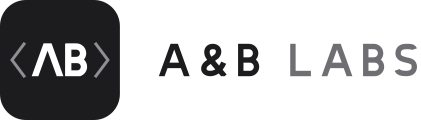

  <picture>
    <source media="(prefers-color-scheme: dark)" srcset="assets/ablabs-lockup-horizontal-white.svg">
    
  </picture>

<strong>We make our own software. And we build yours.</strong>

A&B Labs is a small software company based in Portugal. We build custom websites and applications for schools, institutions and companies, and we are developing products of our own. You can count on our commitment to every project, and on a team that stays close to you, from the first conversation to launch and beyond.

## What we do

- **Client work:** websites and applications made to measure for small and medium-sized projects, from requirements and interface design to development. If a project needs hosting and maintenance, we handle it in-house, with no middlemen.
- **Our own products:** applications and services under our own brand, currently in development. Once they launch, we will host, maintain and improve them ourselves.

## What we believe in

- **Transparency:** we explain what is included, what it costs and how long it will take, and tell you early when something changes.
- **Responsibility:** we stand by what we promise and answer for what we deliver, after launch too.
- **Quality:** we would rather do less and do it well. Every delivery has to meet a standard we are proud of.
- **Commitment:** we take each client's vision as seriously as our own, with motivation and professionalism from start to finish.
- **Realism:** we only take on what we can deliver. Turning a project down is better than promising what we can't do.
- **Balance:** family and well-being come first. A team that is doing well does better work, so we plan deadlines that allow for it.

## How we work

1. **Understand first, then promise.** At the first conversation we work out whether we can meet your needs, and tell you before anything starts if we can't.
2. **Everything agreed in writing.** Scope, deadlines, technology, hosting and the number of included review rounds go into a contract signed by both sides.
3. **Clear rules for revisions and changes.** A revision refines what was approved; a scope change alters what was agreed. Both are priced and agreed before we go ahead.
4. **The code is yours.** Once the final payment is made, the code belongs to you, with technical documentation and user guides, and no lock-in.
5. **Accessible and private from the start.** We build to WCAG 2.1 AA, host projects only in the European Union, comply with the GDPR, and don't use dark patterns or invasive tracking.
6. **Still here after launch.** Every project includes a 30-day warranty. After that, you can take out a maintenance plan, and we check in a year or two later to review the impact and suggest improvements.

## Recent work

- **[Alvaiázere School Group website](https://agalvaiazere.pt):** a new institutional website for the Agrupamento de Escolas de Alvaiázere, with a custom WordPress theme, light and dark modes, and a focus on accessibility.

## Get in touch

Have a project in mind? Email us at [support@ablabs.pt](mailto:support@ablabs.pt). We reply to every message, usually within two business days, and we'll tell you honestly whether we are the right team for your project.

Software made with ♥ in Portugal.

